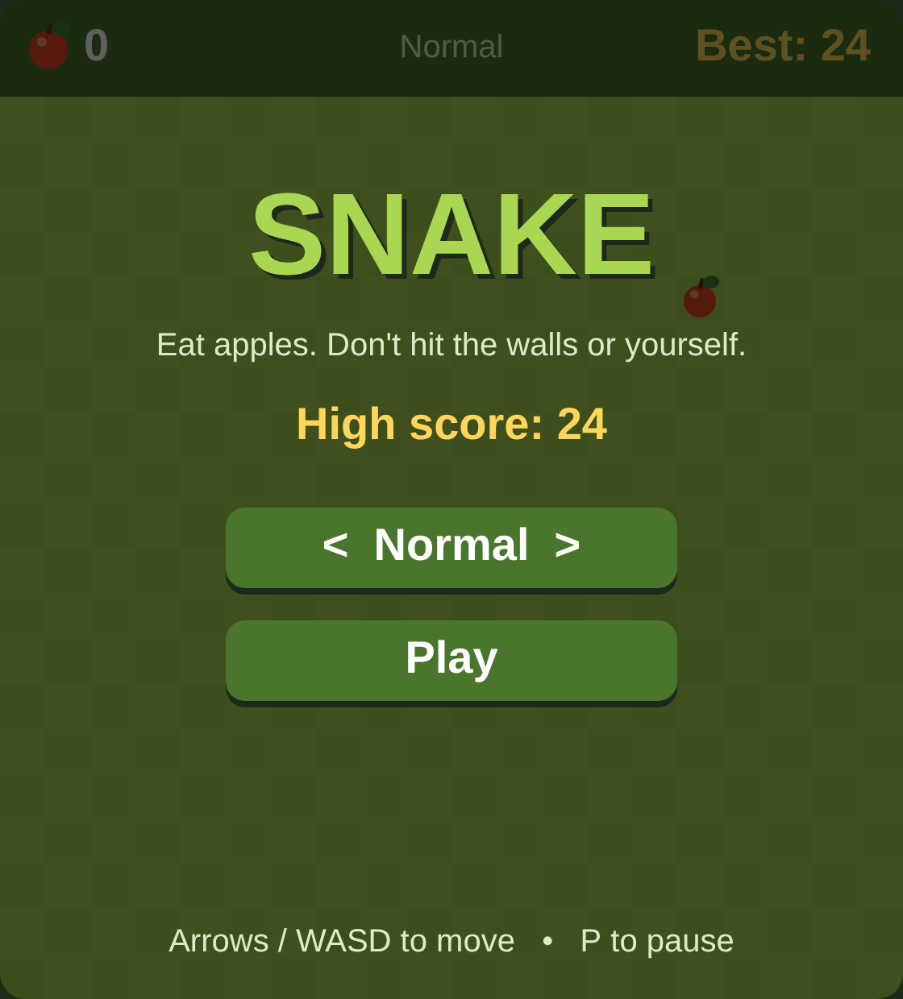
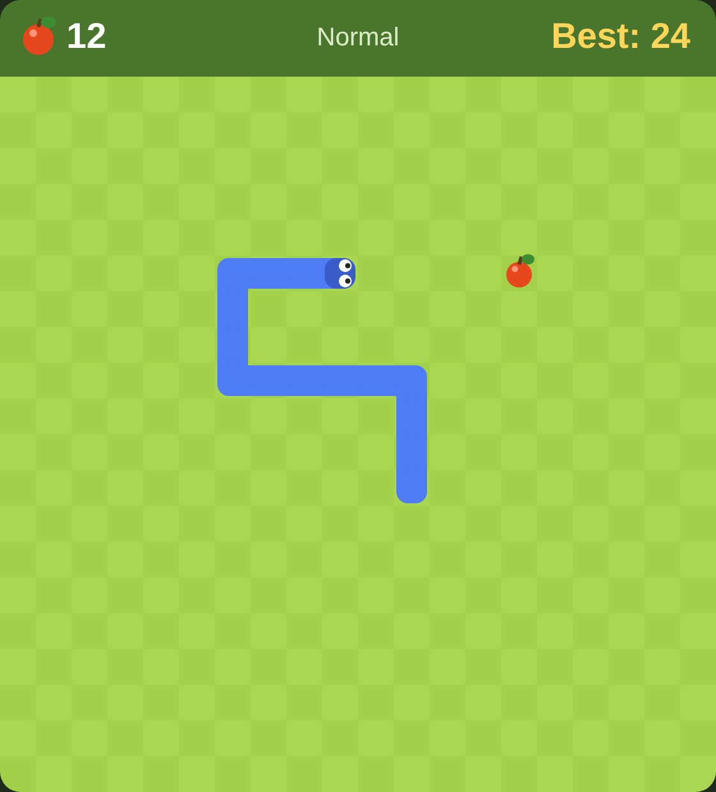
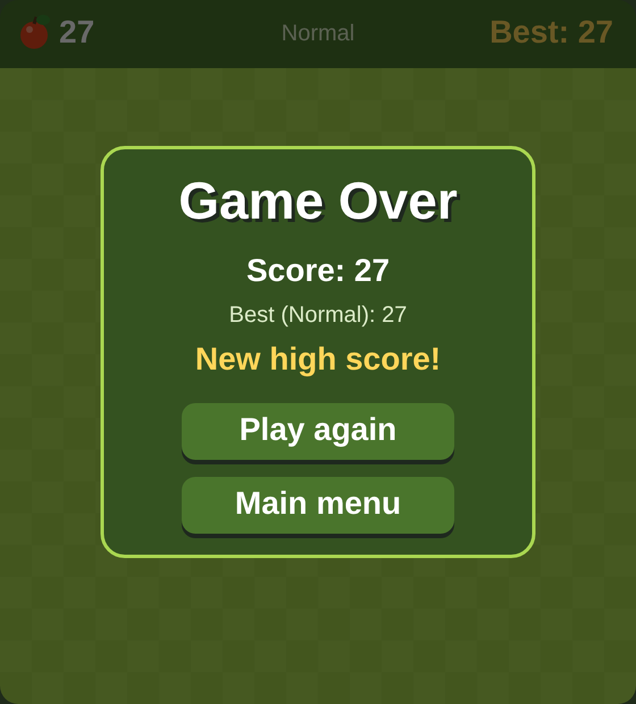

# 🐍 Snake

A classic Snake game with a start menu, three difficulty levels, pause and a saved high score.

I first wrote it in **Python** with **pygame**, then rewrote it in **JavaScript** (HTML Canvas) so it can be played instantly in the browser. Both versions have the same logic and look, and all the graphics are drawn in code, with no image files.

**▶ Play it here:** https://20kita.github.io/snake-python/

<p align="center">
  
  
  
</p>

---

## Table of contents

1. [Features](#features)
2. [Controls](#controls)
3. [Two versions](#two-versions)
4. [Project structure](#project-structure)
5. [Running the game](#running-the-game)
6. [How it works](#how-it-works)
7. [Why I rewrote it in JavaScript](#why-i-rewrote-it-in-javascript)
8. [What I learned](#what-i-learned)

---

## Features

- **Start menu** with clickable buttons
- **Three difficulty levels**: Easy, Normal and Hard, each with a different snake speed
- **High score saved for each difficulty**, kept after closing the game
- **Pause** at any time
- **Game over screen** with the score, the best score and a "New high score!" message
- **"You win!"** if the snake fills the whole board
- **Graphics drawn in code**: checkered board, a smooth snake body, eyes that look where the snake is going, and an apple with a leaf

Extra in the browser version:
- **Phone support**: swipe to turn, tap the top bar to pause
- **Auto-pause** when you switch tabs or click outside the game
- **Scales to any screen size** and stays sharp on high-resolution screens

## Controls

| Action | Keyboard | Phone |
|---|---|---|
| Move | Arrows or WASD | Swipe |
| Pause / resume | P or Esc | Tap the top bar |
| Start / play again | Enter or Space, or click the button | Tap the button |
| Change difficulty (menu) | ← → or A D, or click the button | Tap the button |
| Back to menu (game over) | Esc, or click the button | Tap the button |

---

## Two versions

| | Python version | JavaScript version |
|---|---|---|
| File | `main.py` | `index.html`, `style.css`, `game.js` |
| Language | Python 3 | HTML, CSS, JavaScript |
| Library | pygame-ce | none (HTML Canvas) |
| Runs | on a computer | in any browser, also on phones |
| High score saved in | `highscore.json` | the browser's `localStorage` |

## Project structure

```
snake-python/
├── index.html       # the web page: a <canvas> for the game, loads style.css and game.js
├── style.css        # centers the game and scales it to the screen
├── game.js          # the JavaScript version of the game
├── main.py          # the Python version of the game
└── screenshots/     # images used in this README
```

Both `game.js` and `main.py` are built the same way:

| Part | What it does |
|---|---|
| Settings and colors | Board size, speeds and all colors in one place |
| Load / save high scores | Read and write the best scores |
| `Button` class | A reusable clickable button with a hover effect |
| `Game` → `step()` | Moves the snake, handles eating and collisions |
| `Game` → input handling | Keyboard, mouse (and touch in JS) for each state |
| `Game` → `draw...()` methods | Drawing the board, snake, apple, menus and screens |
| `Game` → main loop | Runs the game frame by frame |

---

## Running the game

### JavaScript version
Just open `index.html` in a browser; nothing needs to be installed. It's also live at https://20kita.github.io/snake-python/.

### Python version
1. Install pygame:
   ```
   pip install pygame-ce
   ```
2. Run the game:
   ```
   python main.py
   ```

---

## How it works

### The game loop
The game runs in a loop, about 60 times per second. Each time, it:
1. **reads the input** (keys, mouse, touch),
2. **updates the game** (moves the snake when it's time),
3. **draws everything**.

In Python, this is a `while True` loop. In JavaScript, `requestAnimationFrame()` asks the browser to call the loop again before the next screen refresh.

The snake moves slower than the screen refreshes. A timer adds up the time between frames and moves the snake once every `1000 / speed` milliseconds, which is how the difficulty levels work.

### Grid and the snake
The board is a 20 × 20 grid. All the game logic uses grid positions like `(5, 3)`; they're changed into pixels only when drawing.

The snake is a list of positions, with the head first:

```js
[[10, 10], [9, 10], [8, 10]]
```

Every step, a new head is added at the front and the tail is removed. When the snake eats an apple, the tail is **not** removed, and that's how it grows.

### Turning
Key presses go into a small queue, and the snake takes one turn from it each step. This way, quick key presses are never lost. Turning straight back into yourself (a 180° turn) is blocked.

### Collisions
The game ends when the new head is outside the board or lands on the snake's body. The tail moves away in the same step, so the snake can safely follow its own tail, unless it's growing.

### Game states
The game is always in one of four states: `menu`, `playing`, `paused` or `game_over`. The state decides what each key does and which screen is drawn. Pausing just stops the snake from moving.

### Apples
A new apple is placed on a random **free** square: the game makes a list of all squares that are not part of the snake and picks one. If there are no free squares left, the player wins.

### High score
The scores are stored as one value per difficulty:

```json
{ "Easy": 5, "Normal": 24, "Hard": 9 }
```

- **Python:** saved to `highscore.json` using the `json` module.
- **JavaScript:** websites can't write files on the visitor's computer, so the scores are saved in the browser's `localStorage`.

Both use `try` / `except` (Python) or `try` / `catch` (JavaScript), so if saving isn't possible, the game still works.

### Drawing
Everything is made from simple shapes:
- **Board:** squares in two shades of green. It's drawn once and reused every frame, which is faster.
- **Snake:** rounded rectangles, plus small rectangles filling the gaps between them, so the body looks like one piece.
- **Eyes:** placed using the snake's direction, so they always look forward.
- **Apple:** a red circle, a light circle for the shine, a line for the stem and an ellipse for the leaf.

---

## Why I rewrote it in JavaScript

At first I put the Python version on the web with **pygbag**, a tool that runs pygame games in the browser. It worked, but every visitor had to wait while the browser downloaded a whole Python interpreter and pygame before the game could start.

Browsers run JavaScript natively, so the JavaScript version starts **instantly**. The logic stayed the same; only the language changed. For example:

| Python | JavaScript |
|---|---|
| `self.snake.insert(0, new_head)` | `this.snake.unshift(newHead)` |
| `self.snake.pop()` | `this.snake.pop()` |
| `py.draw.rect(...)` | `ctx.fillRect(...)` |
| `while True:` + `clock.tick(FPS)` | `requestAnimationFrame(...)` |
| `highscore.json` | `localStorage` |

## What I learned

- Building a game around a **game loop** and **states**
- Using **classes** to organize code (`Game`) and to make reusable parts (`Button`)
- Keeping the game logic (grid) separate from the drawing (pixels)
- Saving data with **JSON**, and handling errors
- **Rewriting a project in another language**, and choosing the right technology for where the project will run
- Adding **touch controls** and making a game **responsive**
- Publishing a project on **GitHub Pages**

---

Made by **Natalia Cieszyńska** · [Portfolio](https://20kita.github.io/kita-portfolio/) · [GitHub](https://github.com/20kita)
